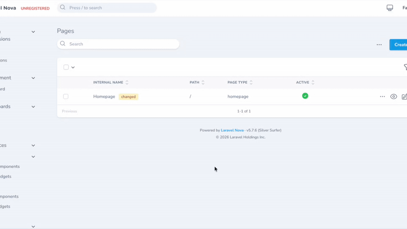
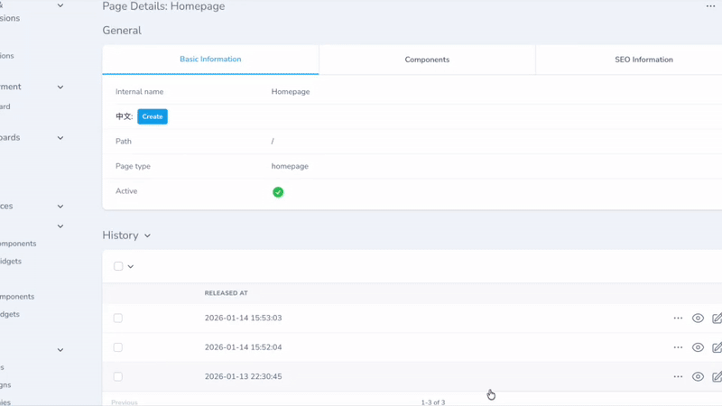

<p align="center"></p>

[中文版本](docs/README_zh.md)




# Laravel Nova Page

A powerful Laravel Nova 5 package for managing pages and building page components.

## Prerequisites

This package requires:

- PHP ^8.2
- Laravel 11.x
- Nova ^5.0

## Features (Client-Oriented)

- 🔄 **Dynamic Arrangement of Page Components**
- 👀 **Preview** - Requires custom frontend development
- 🔒 **Permission Control**
- 📈 **Flexible SEO Configuration**
- ⏰ **Scheduled Publishing**
- ⚡ **CDN + Static Deployment** - High performance
- 🔄 **Multiple Versions** - Easy rollback to previous versions
- 💾 **Stash & Restore** - Save drafts without publishing and compare versions

## Features (Developer-Oriented)

- 🚀 Most classes can be customized via the nova-page.php configuration file.
- 🔧 **Flexible Content** - Integrated with `whitecube/nova-flexible-content` for complex content blocks
- 🔒 Permissions can be overridden

## Headless release pages

This package registers GET /headless/releases/{releaseId}/pages?path=/ and serves page projections from the frozen release manifest owned by CMS Core. The shared /headless prefix and middleware are configured in nova-cms.headless; override the page path with:

~~~env
NOVA_PAGE_HEADLESS_RELEASE_PAGES_PATH=releases/{releaseId}/pages
~~~

Running php artisan cms:page:init adds this environment key to the host .env if it is missing. An existing value is preserved; if .env does not exist, initialization skips the file and reports it.

## Draft page preview

The Nova **Preview** action opens the configured Astro preview route and passes a short-lived, page-specific preview token. Configure the full Astro URL in the Laravel host `.env`:

~~~env
NOVA_PAGE_PAGE_PREVIEW_URL=http://localhost:4321/preview
~~~

For production, use the public Astro URL, for example `https://www.example.com/preview`. The Astro project must have `PUBLIC_CMS_URL` set to the Laravel host URL and allow browser requests from the Astro origin through Laravel CORS configuration.

Laravel exposes `GET /headless/preview/draft?page={path}`. The preview token is sent as a Bearer token, is bound to the selected page and exact path, and expires after 10 minutes. The response contains the current draft projection and is marked private/no-store. The configured Astro route must be `/preview` (or another route using the same draft-preview client).

## Installation

1. Install the package via Composer:

```bash
composer config repositories.fayne/laravel-nova-page '{"type": "git", "url": "git@github.com:Fayne/laravel-nova-page.git"}' --file composer.json

composer require fayne/laravel-nova-page
```

2. Publish and run migrations:

```bash
php artisan vendor:publish --provider="Fayne\Page\PageServiceProvider" --tag="migrations"
php artisan migrate
```

3. Publish resource view file (optional):

```bash
php artisan vendor:publish --provider="Fayne\Page\PageServiceProvider" --tag="view"
```


4. Publish configuration file (optional):

```bash
php artisan vendor:publish --provider="Fayne\Page\PageServiceProvider" --tag="config"
```

## Version Control & Stashing
 
The package includes a robust version control system that allows you to manage page content safely.
 
### Stash Changes
 
If you have made edits to a page but aren't ready to publish them, or if you want to experiment without affecting the live version, you can use the **Stash Changes** action.
 
1. Select the page you are working on in the resource index.
2. Run the **Stash Changes** action.
3. You can optionally add a note to describe your changes.
4. The system will:
   - Save your current work as a "Stashed" revision.
   - Revert the main page content back to the latest **published** version.
   - Mark the page with a `stashed` badge.
 
### History & Restore
 
Every time you publish a page or stash changes, a revision is created. You can view these in the **History** tab of a Page detail view.
 
- **Restore Revision**: You can select any past revision (whether it was a Release or a Stash) and restore its content to the current page.
- **Revision Types**:
  - `Release`: Created automatically when a deployment happens.
  - `Stash`: Created manually when you stash changes.
 
### Compare Revisions
 
You can compare the differences between versions to see exactly what has changed.
 
1. Go to the **History** section of a page.
2. Select **one** revision to compare it against the *current* page content.
3. OR select **two** revisions to compare them against each other.
4. Run the **Compare Revisions** action.
5. A modal will open showing a side-by-side diff of the content and components.

## Configuration

The configuration file allows you to customize various aspects of the menu system:

### Field Resolvers

The `class` field in `nova_page_component_fields` and `nova_page_widget_fields` tables has been replaced by a `resolver` field. This allows for more flexibility in mapping field types to specific Nova field classes.

You can configure the mapping in `config/nova-cms.php` under the `fields` key:

```php
'fields' => [
    'text' => \Fayne\SearchableTextField\SearchableText::class,
    'textarea' => \Laravel\Nova\Fields\Textarea::class,
    // ... other field mappings
],
```

This decoupling allows you to swap out implementations for specific field types without modifying the database content.

### TODO

- [ ] Relate to menus
- [ ] Helper methods for API
- [ ] Unit tests

### Testing

```bash
# Run tests
composer test

# Run tests with coverage
composer test-coverage
```

## Contributing

1. Create a feature branch
2. Make changes
3. Add tests for new features
4. Ensure all tests pass
5. Submit a pull request

## License

This package is licensed under the [Proprietary License](./LICENSE.md).
