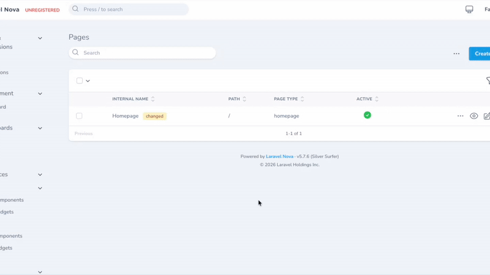
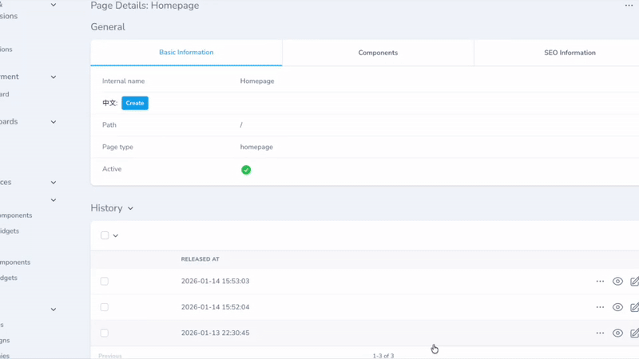

<p align="center"></p>




[English Version](../README.md)

# Laravel Nova Page

一个强大的 Laravel Nova 5 包，用于管理页面和构建页面组件。

## 先决条件

此包需要以下内容：

- PHP ^8.2
- Laravel 11.x
- Nova ^5.0

## 功能（面向客户）

- 🎯 **页面组件动态排列**
- 🎨 **预览** - 前端需要定制开发
- 🚀 **权限控制**
- 🎛️ **SEO 灵活配置**
- **定时发布**
- **CDN + 静态部署** - 高性能
- **多版本** - 轻松回退之前的版本
- 💾 **暂存与还原** - 保存草稿而不发布，并支持版本对比

## 功能（面向开发）

- 🚀 大多数类可以通过 nova-page.php 配置文件自定义。
- 🔧 **灵活内容** - 与 `whitecube/nova-flexible-content` 集成，用于复杂内容块
- 🔒 权限可以被覆盖

## Headless Release 页面接口

本包注册 GET /headless/releases/{releaseId}/pages?path=/，并从 CMS Core 的冻结 release manifest 读取页面投影。共享 /headless 前缀和 middleware 配置位于 nova-cms.headless；页面路径可通过以下环境变量覆盖：

~~~env
NOVA_PAGE_HEADLESS_RELEASE_PAGES_PATH=releases/{releaseId}/pages
~~~

运行 php artisan cms:page:init 时，如果宿主 .env 中缺少该变量，就会追加默认值；已有值不会覆盖。.env 不存在时会提示并跳过。

## 安装

1. 通过 Composer 安装包：

```bash
composer config repositories.fayne/laravel-nova-page '{"type": "git", "url": "git@github.com:Fayne/laravel-nova-page.git"}' --file composer.json

composer require fayne/laravel-nova-page
```

2. 发布并运行迁移：

```bash
php artisan vendor:publish --provider="Fayne\Page\PageServiceProvider" --tag="migrations"
php artisan migrate
```

3. 发布视图文件（可选）：

```bash
php artisan vendor:publish --provider="Fayne\Page\PageServiceProvider" --tag="view"
```

4. 发布配置文件（可选）：

```bash
php artisan vendor:publish --provider="Fayne\Page\PageServiceProvider" --tag="config"
```

## 版本控制与暂存 (Version Control & Stashing)

本扩展包包含一个强大的版本控制系统，允许您安全地管理页面内容。

### 暂存更改 (Stash Changes)

如果您对页面进行了编辑但尚未准备好发布，或者想在不影响线上版本的情况下进行尝试，可以使用 **暂存更改 (Stash Changes)** 操作。

1. 在资源列表中选择您正在操作的页面。
2. 运行 **暂存更改 (Stash Changes)** 操作。
3. 您可以选择添加备注以描述您的更改。
4. 系统将：
   - 将您当前的工作保存为“暂存 (Stashed)”版本。
   - 将主页面内容回滚到最新的 **已发布** 版本。
   - 为页面标记 `stashed` 徽章。

### 历史与还原 (History & Restore)

每次发布页面或暂存更改时，都会创建一个修订版本。您可以在页面详情视图的 **History** 标签页中查看这些内容。

- **还原版本 (Restore Revision)**：您可以选择任何过去的修订版本（无论是发布版还是暂存版），并将其内容还原到当前页面。
- **版本类型**：
  - `Release`：发生部署时自动创建。
  - `Stash`：手动暂存更改时创建。

### 对比版本 (Compare Revisions)

您可以对比版本之间的差异，确切地查看发生了哪些变化。

1. 进入页面的 **History** 部分。
2. 选择 **一个** 修订版本将其与 *当前* 页面内容进行对比。
3. 或者选择 **两个** 修订版本进行相互对比。
4. 运行 **对比版本 (Compare Revisions)** 操作。
5. 将打开一个模态框，并排显示内容和组件的代码差异 (Diff)。

## 配置

配置文件允许您自定义菜单系统的各个方面：

### TODO

- [ ] helper方法for API
- [ ] Unit tests

### 测试

```bash
# 运行测试
composer test

# 运行带覆盖率的测试
composer test-coverage
```

## 贡献

1. 创建功能分支
2. 进行更改
3. 为新功能添加测试
4. 确保所有测试通过
5. 提交拉取请求

## 许可证

此包是根据 [专有许可证](../LICENSE.md) 许可的软件。
